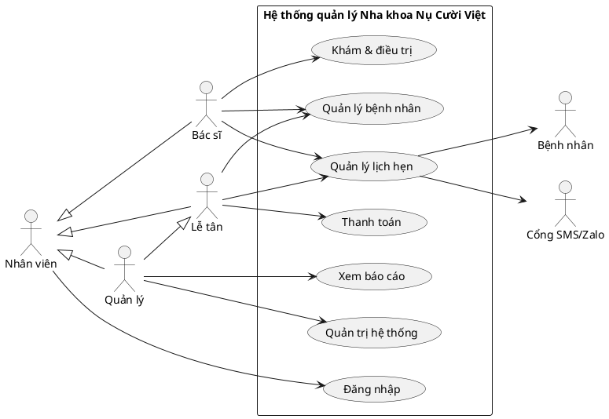
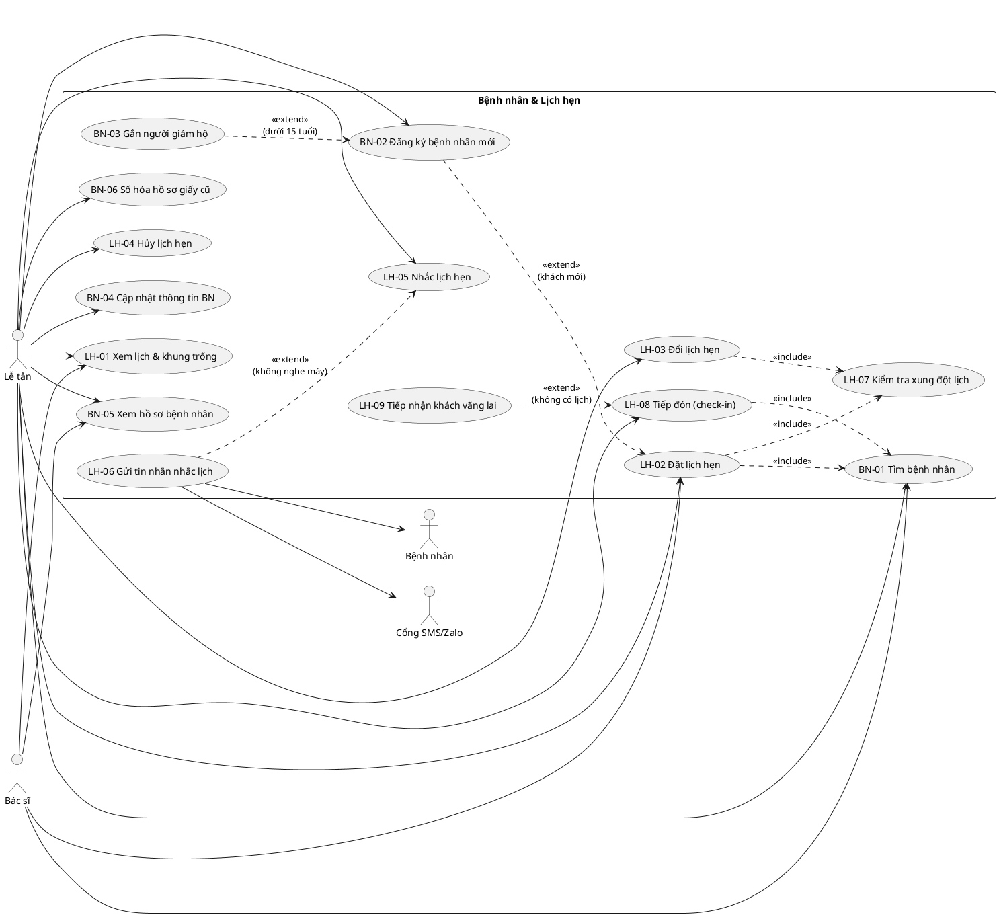
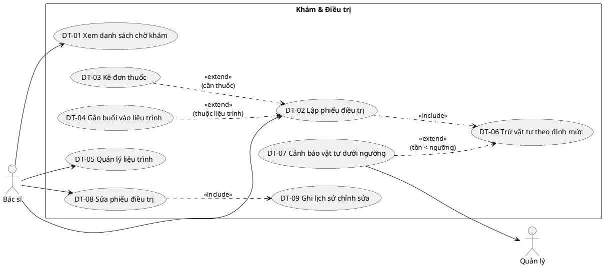
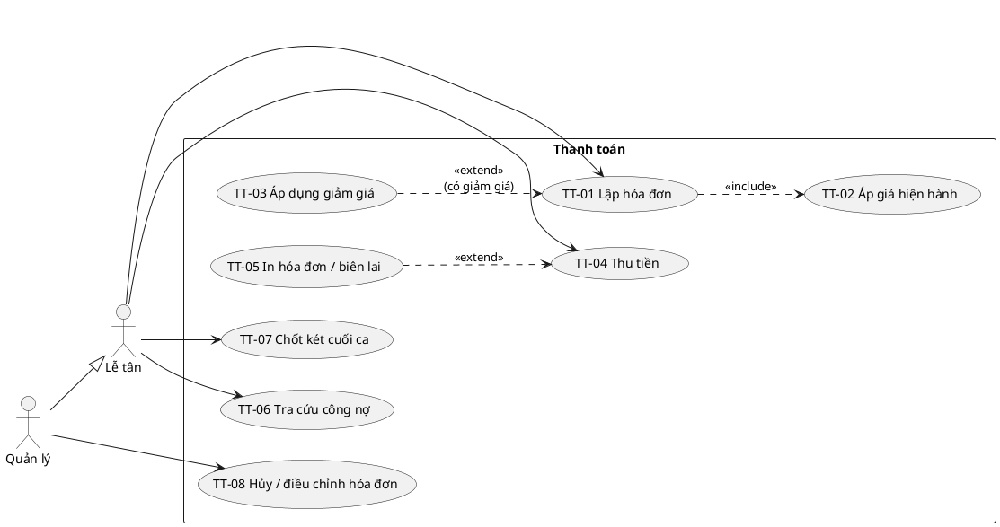
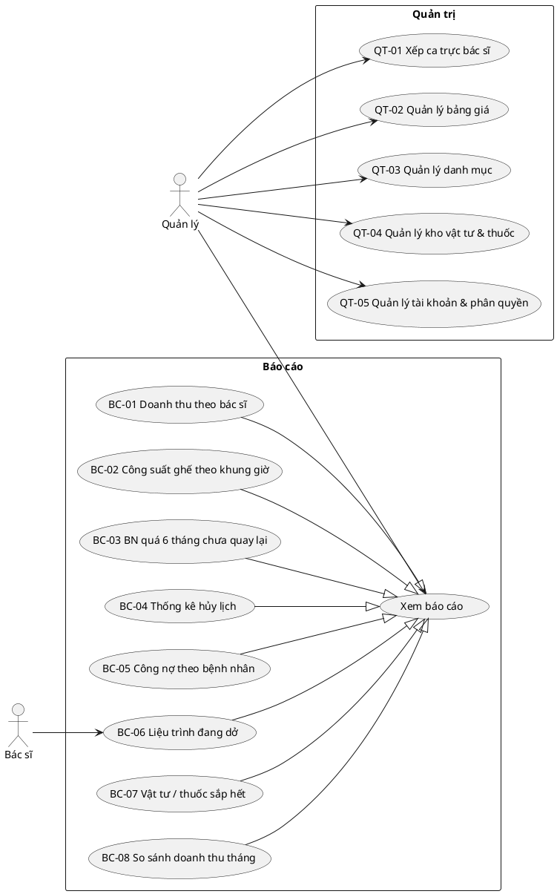

# Phân tích Use Case — Hệ thống quản lý Nha khoa Nụ Cười Việt

> Nguồn: ghi chép khảo sát (Bài tập 1, phần 1/2 và 2/2).
> File `dac-ta-phong-kham.md` (mẫu sổ hẹn, phiếu điều trị, bảng giá) chưa có trong dự án — khi có cần đối chiếu lại các trường dữ liệu.
> Sơ đồ viết bằng PlantUML (xem bằng extension *PlantUML* trong VS Code hoặc plantuml.com).

---

## 1. Phạm vi

Hệ thống web nội bộ thay cho sổ hẹn giấy, file Excel bảng giá, phiếu điều trị viết tay và hồ sơ giấy. Một cơ sở, 3 ghế, 4 bác sĩ, 2 lễ tân, 1 quản lý.

**Ngoài phạm vi giai đoạn 1:** bệnh nhân tự đặt lịch online, tích hợp ngân hàng/cổng thanh toán, kết nối bảo hiểm, đa chi nhánh.

---

## 2. Tác nhân (Actor)

| Tác nhân | Loại | Vai trò trong hệ thống |
|---|---|---|
| **Nhân viên** | Trừu tượng | Tác nhân cha của Lễ tân, Bác sĩ, Quản lý — dùng chung UC Đăng nhập |
| **Lễ tân** | Chính | Tiếp nhận bệnh nhân, đặt/đổi/hủy lịch, nhắc lịch, lập hóa đơn, thu tiền, chốt két |
| **Bác sĩ** | Chính | Xem lịch của mình, lập/sửa phiếu điều trị, kê thuốc, quản lý liệu trình, hẹn tái khám |
| **Quản lý** | Chính | Xếp ca trực, bảng giá, danh mục, kho vật tư, tài khoản, xem báo cáo. **Kế thừa Lễ tân** (làm thay được khi thiếu người) |
| **Bệnh nhân** | Phụ | Không đăng nhập hệ thống ở giai đoạn 1; chỉ nhận tin nhắn nhắc lịch |
| **Cổng SMS / Zalo** | Phụ (hệ thống ngoài) | Gửi tin nhắn nhắc lịch cho bệnh nhân |

---

## 3. Danh sách Use Case

### 3.1. Chung
| Mã | Use case | Tác nhân |
|---|---|---|
| UC-00 | Đăng nhập / Đăng xuất / Đổi mật khẩu | Nhân viên |

### 3.2. Bệnh nhân (BN)
| Mã | Use case | Tác nhân | Ghi chú |
|---|---|---|---|
| BN-01 | Tìm bệnh nhân | Lễ tân, Bác sĩ | Theo SĐT hoặc tên; **một SĐT có thể trả về nhiều bệnh nhân** |
| BN-02 | Đăng ký bệnh nhân mới | Lễ tân | `<<include>>` Kiểm tra trùng hồ sơ |
| BN-03 | Gắn người giám hộ | Lễ tân | `<<extend>>` BN-02 khi bệnh nhân dưới 15 tuổi |
| BN-04 | Cập nhật thông tin bệnh nhân | Lễ tân | |
| BN-05 | Xem hồ sơ bệnh nhân | Lễ tân, Bác sĩ | Lịch sử khám, liệu trình, đơn thuốc, công nợ |
| BN-06 | Số hóa hồ sơ giấy cũ | Lễ tân, Quản lý | ~4.100 hồ sơ từ 2019; nhập thông tin hành chính + đính kèm ảnh scan |

### 3.3. Lịch hẹn (LH)
| Mã | Use case | Tác nhân | Ghi chú |
|---|---|---|---|
| LH-01 | Xem lịch và khung trống | Lễ tân, Bác sĩ | Lọc theo ngày / bác sĩ / ghế; chỉ hiện khung trong ca trực |
| LH-02 | Đặt lịch hẹn | Lễ tân, Bác sĩ | `<<include>>` BN-01, LH-07; `<<extend>>` BN-02 nếu khách mới. Bác sĩ dùng để hẹn tái khám |
| LH-03 | Đổi lịch hẹn | Lễ tân | `<<include>>` LH-07 |
| LH-04 | Hủy lịch hẹn | Lễ tân | Bắt buộc lý do; hệ thống tự ghi người hủy, thời điểm |
| LH-05 | Nhắc lịch hẹn | Lễ tân | Danh sách lịch ngày mai; ghi kết quả gọi |
| LH-06 | Gửi tin nhắn nhắc lịch | Lễ tân, Cổng SMS, Bệnh nhân | `<<extend>>` LH-05 khi khách không nghe máy |
| LH-07 | Kiểm tra xung đột lịch | (hệ thống) | Được include: ghế trống, bác sĩ trống, nằm trong ca trực |
| LH-08 | Tiếp đón bệnh nhân (check-in) | Lễ tân | `<<include>>` BN-01; chuyển lịch sang "Đã đến", đưa vào hàng chờ |
| LH-09 | Tiếp nhận khách vãng lai | Lễ tân | `<<extend>>` LH-08 khi khách không có lịch → tạo lịch tại chỗ |

### 3.4. Khám & điều trị (DT)
| Mã | Use case | Tác nhân | Ghi chú |
|---|---|---|---|
| DT-01 | Xem danh sách chờ khám | Bác sĩ | Theo bác sĩ / ghế trong ngày |
| DT-02 | Lập phiếu điều trị | Bác sĩ | Mỗi dòng: dịch vụ + số răng + bác sĩ thực hiện. `<<include>>` DT-06 |
| DT-03 | Kê đơn thuốc | Bác sĩ | `<<extend>>` DT-02; tên thuốc, liều dùng, số lượng |
| DT-04 | Gắn buổi vào liệu trình | Bác sĩ | `<<extend>>` DT-02; ghi buổi thứ mấy |
| DT-05 | Quản lý liệu trình | Bác sĩ | Tạo (niềng, implant), cập nhật số buổi dự kiến, kết thúc |
| DT-06 | Trừ vật tư theo định mức | (hệ thống) | Được include khi lưu phiếu; bác sĩ chỉnh số lượng nếu khác định mức |
| DT-07 | Cảnh báo vật tư dưới ngưỡng | Quản lý (nhận) | `<<extend>>` DT-06 khi tồn kho < ngưỡng |
| DT-08 | Sửa phiếu điều trị | Bác sĩ | `<<include>>` DT-09 |
| DT-09 | Ghi lịch sử chỉnh sửa | (hệ thống) | Lưu ai sửa, lúc nào, nội dung trước/sau |

### 3.5. Thanh toán (TT)
| Mã | Use case | Tác nhân | Ghi chú |
|---|---|---|---|
| TT-01 | Lập hóa đơn | Lễ tân | Từ phiếu điều trị; `<<include>>` TT-02 |
| TT-02 | Áp giá hiện hành | (hệ thống) | Chụp giá tại thời điểm lập vào từng dòng; đổi bảng giá sau đó không ảnh hưởng |
| TT-03 | Áp dụng giảm giá | Lễ tân | `<<extend>>` TT-01; ghi người áp dụng + lý do |
| TT-04 | Thu tiền | Lễ tân | Thu nhiều lần trên một hóa đơn; mỗi lần ghi tiền mặt / chuyển khoản. Dùng cho cả thu nợ cũ và thu đợt liệu trình |
| TT-05 | In hóa đơn / biên lai | Lễ tân | `<<extend>>` TT-04 |
| TT-06 | Tra cứu công nợ | Lễ tân, Quản lý | Công nợ của một bệnh nhân / một hóa đơn |
| TT-07 | Chốt két cuối ca | Lễ tân | Nhập tiền đếm thực tế, so với tiền mặt đã thu trong ca |
| TT-08 | Hủy / điều chỉnh hóa đơn | Quản lý | Không xóa; ghi lý do, người thực hiện |

### 3.6. Quản trị (QT)
| Mã | Use case | Tác nhân | Ghi chú |
|---|---|---|---|
| QT-01 | Xếp ca trực bác sĩ | Quản lý | Theo ngày, ca sáng / chiều; bác sĩ bán thời gian 3 ngày/tuần |
| QT-02 | Quản lý bảng giá | Quản lý | Tạo giá mới có ngày hiệu lực, không ghi đè giá cũ |
| QT-03 | Quản lý danh mục | Quản lý | Dịch vụ, ghế, thuốc, lý do hủy, định mức vật tư theo dịch vụ |
| QT-04 | Quản lý kho vật tư & thuốc | Quản lý | Nhập kho, kiểm kê, đặt ngưỡng tối thiểu |
| QT-05 | Quản lý tài khoản & phân quyền | Quản lý | |

### 3.7. Báo cáo (BC) — tổng quát hóa từ "Xem báo cáo"
| Mã | Báo cáo | Câu hỏi của quản lý | Tác nhân |
|---|---|---|---|
| BC-01 | Doanh thu theo bác sĩ | Tháng này mỗi bác sĩ làm ra bao nhiêu tiền | Quản lý |
| BC-02 | Công suất ghế theo khung giờ | Ghế nào trống nhiều nhất, vào khung giờ nào | Quản lý |
| BC-03 | Bệnh nhân lâu chưa quay lại | Bệnh nhân nào quá 6 tháng chưa quay lại | Quản lý, Lễ tân |
| BC-04 | Thống kê hủy lịch | Việc gì hay bị hủy nhất, vì lý do gì | Quản lý |
| BC-05 | Công nợ theo bệnh nhân | Tổng tiền khách còn nợ, chia theo từng người | Quản lý |
| BC-06 | Liệu trình đang dở | Liệu trình nào đang dở, còn mấy buổi | Quản lý, Bác sĩ |
| BC-07 | Vật tư / thuốc sắp hết | Thuốc hay vật tư nào sắp hết | Quản lý |
| BC-08 | So sánh doanh thu theo tháng | Doanh thu tăng/giảm bao nhiêu % so với tháng trước | Quản lý |

---

## 4. Sơ đồ Use Case

### 4.1. Tổng quan

### 4.2. Bệnh nhân & lịch hẹn

### 4.3. Khám & điều trị

### 4.4. Thanh toán

### 4.5. Quản trị & báo cáo

---

## 5. Đặc tả các use case cốt lõi

### LH-02 Đặt lịch hẹn
- **Tác nhân:** Lễ tân (chính), Bác sĩ (hẹn tái khám)
- **Tiền điều kiện:** Đã đăng nhập; bác sĩ được chọn đã có ca trực vào ngày đó.
- **Luồng chính:**
  1. Lễ tân nhập SĐT → hệ thống trả danh sách bệnh nhân có SĐT đó (BN-01).
  2. Lễ tân chọn đúng bệnh nhân (theo tên + ngày sinh).
  3. Lễ tân chọn dịch vụ dự kiến, bác sĩ mong muốn, ngày.
  4. Hệ thống hiện các khung 30 phút còn trống của bác sĩ đó trong ca trực, kèm ghế trống.
  5. Lễ tân chọn khung + ghế → hệ thống kiểm tra xung đột (LH-07) → lưu lịch, trạng thái "Đã đặt".
- **Luồng thay thế:**
  - 1a. Không tìm thấy → Đăng ký bệnh nhân mới (BN-02), quay lại bước 3.
  - 3a. Khách không chọn bác sĩ → hệ thống hiện khung trống của mọi bác sĩ đang trực.
  - 5a. Xung đột (ghế hoặc bác sĩ đã có lịch, hoặc ngoài ca trực) → báo lỗi, quay lại bước 4.
- **Hậu điều kiện:** Lịch gắn đúng 1 bệnh nhân, 1 bác sĩ, 1 ghế, 1 khung 30 phút.
- **Giả định:** Việc cần nhiều thời gian (ví dụ cắm implant) đặt nhiều khung liên tiếp cùng bác sĩ + ghế, mỗi khung là một bản ghi được nhóm với nhau.

### LH-04 Hủy lịch hẹn
- **Tác nhân:** Lễ tân
- **Luồng chính:** Chọn lịch → chọn lý do hủy từ danh mục (có ô ghi chú thêm) → xác nhận → hệ thống ghi người hủy, thời điểm hủy, chuyển trạng thái "Đã hủy" và giải phóng khung.
- **Luồng thay thế:** Khách không đến mà không báo → lễ tân đánh dấu "Không đến" (là một lý do hủy đặc biệt, để báo cáo BC-04 thống kê được).
- **Quy tắc:** Không xóa lịch đã hủy.

### DT-02 Lập phiếu điều trị
- **Tác nhân:** Bác sĩ
- **Tiền điều kiện:** Bệnh nhân đã check-in (LH-08).
- **Luồng chính:**
  1. Bác sĩ chọn bệnh nhân từ danh sách chờ → hệ thống tạo phiếu, tự điền ngày, giờ, ghế, bác sĩ chính.
  2. Bác sĩ thêm từng dòng việc đã làm: dịch vụ, **số răng** (theo sơ đồ FDI 11–48, 51–85 cho răng sữa), ghi chú, **bác sĩ thực hiện** (mặc định là bác sĩ chính).
  3. (Tùy chọn) Kê đơn thuốc (DT-03); gắn buổi vào liệu trình (DT-04).
  4. Bác sĩ lưu → hệ thống trừ vật tư theo định mức (DT-06), phiếu chuyển "Chờ thanh toán".
- **Luồng thay thế:**
  - 2a. Dịch vụ không gắn với răng cụ thể (cạo vôi toàn hàm, tư vấn) → chọn "Toàn hàm" / "Hàm trên" / "Hàm dưới".
  - 4a. Tồn kho xuống dưới ngưỡng → gửi cảnh báo tới Quản lý (DT-07).

### TT-01 Lập hóa đơn
- **Tác nhân:** Lễ tân
- **Luồng chính:** Chọn phiếu điều trị "Chờ thanh toán" → hệ thống tạo hóa đơn, mỗi dòng dịch vụ/thuốc lấy giá **đang hiệu lực tại thời điểm lập** và lưu cố định vào dòng (TT-02) → tự tính tổng → (tùy chọn) giảm giá (TT-03) → xác nhận.
- **Quy tắc:** Dòng thuộc liệu trình trọn gói có giá 0 trên hóa đơn buổi (tiền đã tính trong hóa đơn liệu trình).

### TT-04 Thu tiền
- **Tác nhân:** Lễ tân
- **Luồng chính:** Chọn hóa đơn (mới lập hoặc còn nợ) → nhập số tiền, phương thức (tiền mặt / chuyển khoản), mã giao dịch nếu chuyển khoản → hệ thống lưu lần thu, cập nhật **số còn nợ = tổng hóa đơn − tổng các lần thu**.
- **Luồng thay thế:** Số tiền > số còn nợ → không cho lưu.
- **Hậu điều kiện:** Hóa đơn ở trạng thái "Còn nợ" hoặc "Đã thanh toán đủ".

### TT-07 Chốt két cuối ca
- **Tác nhân:** Lễ tân
- **Luồng chính:** Hệ thống tổng hợp các lần thu **tiền mặt** trong ca của lễ tân đó → lễ tân nhập số tiền đếm thực tế → hệ thống tính chênh lệch → lễ tân ghi chú (nếu lệch) → chốt. Sau khi chốt không được thêm hoặc sửa lần thu thuộc ca đó.
- **Giả định:** Chốt theo ca (sáng / chiều) vì có 2 lễ tân chia ca; chuyển khoản đối soát riêng với sao kê, không tính vào két.

---

## 6. Ba chỗ phòng khám đang làm mỗi lần một kiểu — cách xử lý đã chọn

| # | Tình huống | Cách xử lý | Lý do |
|---|---|---|---|
| 1 | Hai bác sĩ cùng làm cho một khách | Phiếu điều trị có **1 bác sĩ chính**; **mỗi dòng dịch vụ ghi bác sĩ thực hiện** | Báo cáo doanh thu theo bác sĩ (BC-01) tính chính xác theo từng dòng, không phải chia đôi tùy ý |
| 2 | Trẻ dưới 15 tuổi dùng SĐT của mẹ | **SĐT không phải khóa định danh.** Mỗi trẻ có hồ sơ riêng (mã BN riêng), SĐT là SĐT liên hệ; trẻ dưới 15 tuổi gắn **người giám hộ** (tên, quan hệ, SĐT). Tìm theo SĐT trả về danh sách, chọn theo tên + ngày sinh | Vẫn giữ thói quen "đọc số điện thoại" ở quầy mà không gộp nhầm hai chị em vào một hồ sơ |
| 3 | Giảm giá lúc ở tổng, lúc ở từng dòng | **Lưu giảm giá ở cấp dòng.** Giao diện cho nhập giảm theo tổng, hệ thống phân bổ xuống các dòng theo tỷ lệ giá trị | Mọi báo cáo (doanh thu theo bác sĩ, theo dịch vụ) chỉ cần cộng ở cấp dòng, không phải xử lý hai kiểu |

---

## 7. Giả định khác

1. **Bệnh nhân không dùng hệ thống** ở giai đoạn 1; vẫn gọi điện cho lễ tân.
2. **Ca trực:** mỗi ngày chia ca sáng (8h–14h) và ca chiều (14h–20h; Chủ nhật 14h–17h). Bác sĩ được xếp theo ca. Giờ chia ca cụ thể cần xác nhận lại với phòng khám.
3. **Khung giờ:** 30 phút cố định; 12 giờ × 2 khung × 3 ghế = 72 khung/ngày (khớp số liệu khảo sát).
4. **Hẹn tái khám:** bác sĩ có thể đặt lịch trực tiếp; nếu bác sĩ không đặt, lễ tân đặt tại quầy khi thanh toán.
5. **Liệu trình** (niềng, implant): có tổng giá trọn gói, số buổi dự kiến và kế hoạch các đợt thanh toán. Một hóa đơn liệu trình được thu nhiều lần — mỗi đợt là một lần thu (TT-04).
6. **Thuốc:** phòng khám phát thuốc tại chỗ, thuốc được quản lý tồn kho giống vật tư và tính tiền trên hóa đơn. Dòng đơn có cờ "mua ngoài" thì không trừ kho, không tính tiền.
7. **Vật tư:** mỗi dịch vụ có định mức vật tư (cấu hình ở QT-03); khi lưu phiếu hệ thống tự trừ, bác sĩ chỉnh được số lượng thực dùng.
8. **Nhắc lịch:** hệ thống chỉ hỗ trợ (danh sách + ghi kết quả + gửi tin), việc gọi điện vẫn do lễ tân làm.
9. **Lưu trữ 5 năm:** không xóa cứng hồ sơ bệnh nhân, phiếu điều trị, hóa đơn; chỉ ẩn/lưu trữ. Thời hạn 5 năm tính từ lần khám cuối.
10. **Số hóa hồ sơ cũ:** chỉ nhập thông tin hành chính + ảnh scan, không nhập lại chi tiết từng phiếu cũ.
11. **Doanh thu bác sĩ (BC-01):** tính theo giá trị dòng dịch vụ sau giảm giá trên hóa đơn đã lập trong tháng; kèm cột "đã thu thực tế". Tỷ lệ chia tiền cho bác sĩ để quản lý tự tính ngoài hệ thống ở giai đoạn 1.
12. **Phân quyền:** lễ tân không sửa được phiếu điều trị; bác sĩ không thu tiền; chỉ quản lý sửa bảng giá, hủy hóa đơn.

---

## 8. Truy vết luật phòng khám → Use case

| Luật phòng khám | Use case đảm bảo |
|---|---|
| Nhận biết bệnh nhân bằng SĐT; trùng tên là chuyện thường | BN-01, BN-02 (mục 6.2) |
| Một lịch = 1 bác sĩ, 1 ghế, 1 khung 30 phút | LH-02 |
| Không trùng giờ trên cùng ghế / cùng bác sĩ | LH-07 |
| Một lần khám nhiều việc, mỗi việc ghi số răng | DT-02 |
| Bảng giá đổi theo thời gian; hóa đơn giữ giá lúc làm | QT-02, TT-02 |
| Niềng / implant gom liệu trình, trả theo đợt | DT-04, DT-05, TT-04 |
| Thuốc kê theo lần khám, có liều dùng + số lượng | DT-03 |
| Một hóa đơn thu nhiều lần, ghi phương thức | TT-04 |
| Luôn biết hóa đơn còn nợ bao nhiêu | TT-04, TT-06, BC-05 |
| Hủy lịch ghi lý do, ai hủy, lúc nào | LH-04 |
| Lịch chỉ xếp vào ca bác sĩ trực | QT-01, LH-07 |
| Giữ hồ sơ 5 năm | Giả định 9 |
| Sửa phiếu phải biết ai sửa, lúc nào | DT-08, DT-09 |
| Vật tư trừ khi dùng; dưới ngưỡng phải báo | DT-06, DT-07, QT-04 |
| Cuối ngày đếm két so với phiếu | TT-07 |
